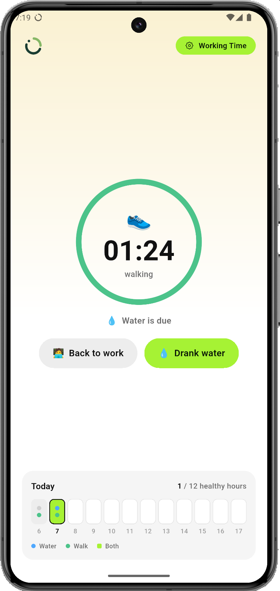
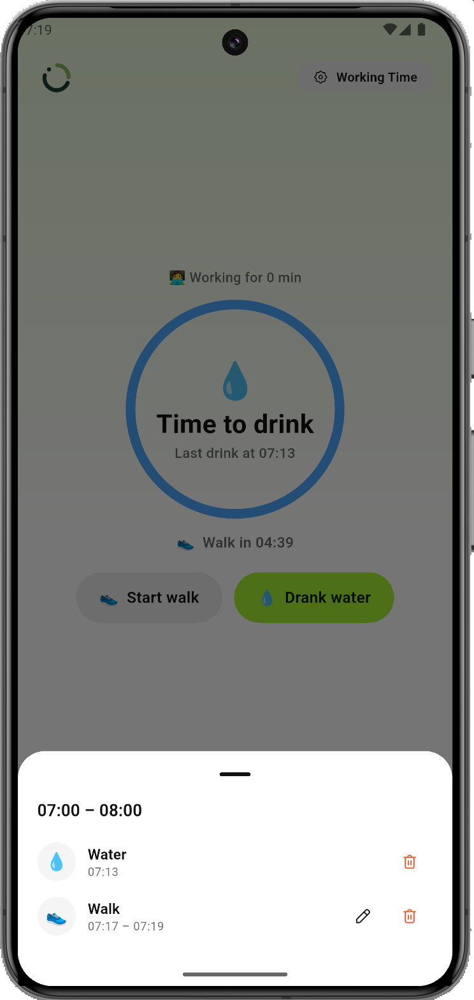
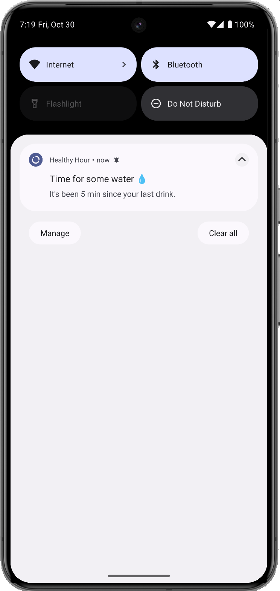
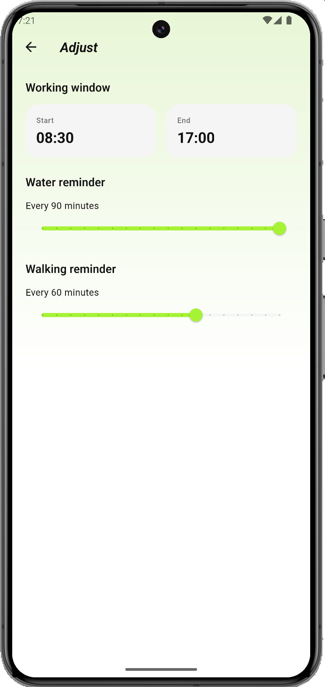

# Healthy Hour

[](https://github.com/kaysman/healthy_hour/actions/workflows/ci.yml)
[](LICENSE)

A Flutter app for **Healthy Hour** — alternates between Working and Walking
sessions and reminds you to drink water and to get up and walk, including
while the app is closed.

Bloc + Hive, feature-first folders inside `lib/`, with a single shared
package for the design system.

> **Status:** built in the open. Sessions, live countdowns and reminders
> work end to end; it is not on any store and has no sync.
> [What's done and what isn't](#status).

## Screens

Home is built around one question — *what should I do right now?* — and
answers it with one thing at a time.

- **One ring.** Whichever habit is due first — the walk or the water —
  fills the ring with its time left. The other habit sits underneath as a
  single line (`💧 Water in 03:10`). How long you've been working is a
  small caption, not the headline.
- **Due.** When the ring hits zero it closes, breathes, and the copy turns
  into the ask: `Time to walk` / `Time to drink`. The background stays the
  Working or Walking tint, like every other screen.
- **Walking.** The ring shows the walk itself — how long you've been up —
  and the main button becomes `Back to work`.
- **Off the clock.** Outside the working window nothing is due and nothing
  counts down: `Reminders start at 09:00`.
- **Two one-tap actions.** `Start walk` / `Back to work` and
  `Drank water`. The one the ring is asking for is the filled button.
  Every tap shows an **Undo** toast for five seconds.
- **The hour grid.** Each hour of the working window is a cell: a blue dot
  when you drank, a green dot when you walked, and a lime cell when you did
  both — a *healthy hour*. The header keeps score (`5 / 9 healthy hours`).
  Tapping an hour that has started opens what was logged in it, where a
  walk's start time can be edited and any walk or drink deleted.

Settings is reached via the `Working Time` button in the top-right.

<table>
  <tr>
    <td width="25%"></td>
    <td width="25%"></td>
    <td width="25%"></td>
    <td width="25%"></td>
  </tr>
  <tr>
    <td valign="top"><b>Walking.</b> The ring shows how long you've been up. Water is due, so <code>Drank water</code> is the filled button. The 07:00 hour has a walk and a drink, so it's a healthy hour.</td>
    <td valign="top"><b>An hour, opened.</b> Water is due behind the sheet (<code>Time to drink</code>). Tapping 07:00 lists what was logged in it: a drink, and a walk whose start can be edited. Either can be deleted.</td>
    <td valign="top"><b>A reminder.</b> Five minutes after the last drink, with the interval set to 5 for the screenshot.</td>
    <td valign="top"><b>Settings</b> carries the same Working/Walking tint as every screen, with a back button to Home.</td>
  </tr>
</table>

### Settings — `/settings`

- **Working window** — start / end time chips; tap to open a `TimePicker`.
  Also sets which hours appear in the grid.
- **Water reminder** — interval slider, 5–90 minutes. Drives the water
  countdown on Home and the water notifications.
- **Walking reminder** — interval slider, same range. Drives the walking
  countdown on Home and the walking notifications.

## How the timer works

There is no countdown, and nothing accumulates elapsed time.

A `Session` stores two fields that matter: `startedAt`, and a nullable
`endedAt`. The session whose `endedAt` is still null is the one you're in.
`HomeBloc` ticks once a second, and the only thing that tick does is push
the current wall-clock `now` into state:

```dart
Duration durationAt(DateTime moment) => (endedAt ?? moment).difference(startedAt);
```

Every number on screen — the ring, the walk duration, the hour grid — is
derived from that. The state object holds no
counter:

```dart
Duration get currentDuration => current?.durationAt(now) ?? Duration.zero;
```

The useful consequence is that there is nothing to drift. Backgrounding the
app, being killed by the OS, or coming back hours later all yield the right
duration, because the duration was never stored — it is recomputed from two
timestamps and the current clock. Editing a past session is just moving a
timestamp, and every derived value follows for free.

The same choice is what makes the day editable at all. Sessions are an
append-only log of what actually happened, not a machine with a running
total, so "delete this walk", "that walk started 10 minutes earlier" or
"undo that tap" are ordinary edits rather than surgery on accumulated state.

`HomeBloc` also takes an injectable `Clock`, which is what makes any of this
testable without waiting in real time.

The two countdowns follow the same rule. Water counts down from the last
logged drink (never from before today's working window opens, so each day
starts full); Walking counts down from the start of the current Working
session. Both are `interval − (now − anchor)`, computed per tick, and the
ring shows whichever is smaller.

The hour grid is the same idea one level up: `healthyHours` in
`domain/entities/` is a pure function of the window, today's sessions,
today's drinks and `now`. An hour counts as walked when any walk overlaps
it, and as drunk when a drink was logged inside it.

## How reminders work

Notifications are planned from the same timestamps, so what the phone
says and what Home shows cannot disagree.

- **A pure planner.** `planReminders` in `domain/usecases/` takes `now`,
  the current session, the last drink, the working window and the two
  intervals, and returns every reminder due from now on. No Flutter, no
  plugin — it is plain Dart and has the largest test file in the repo.
- **Replace, don't diff.** `ReminderCoordinator` watches the session,
  settings and hydration streams. Whenever any of them changes it
  recomputes the whole plan and the scheduler cancels everything pending
  and schedules the new plan. There is no background job and no stored
  schedule to fall out of sync; the OS just holds the latest plan.
- **Only inside the working window**, and water also covers tomorrow's
  window, so the next morning gets reminders without opening the app.
  The plan is capped at 60 entries because iOS keeps at most 64 pending
  local notifications and silently drops the rest.
- **Inexact on purpose.** Android delivery uses
  `inexactAllowWhileIdle`. Exact alarms need `SCHEDULE_EXACT_ALARM`,
  which Android 14 denies by default and Play restricts to alarm and
  calendar apps; a water reminder a minute late costs nothing.

The plugin (`flutter_local_notifications`) sits behind a domain
`ReminderScheduler` interface, so the planner and coordinator are tested
against a fake that records what would have been scheduled.

## Layout

```
healthy_hour/
├─ android/                       # generated by `flutter create`
├─ ios/                           # generated by `flutter create`
├─ lib/
│  ├─ main.dart                   # entrypoint
│  └─ src/
│     ├─ app.dart, app_observer.dart, router.dart
│     ├─ core/                    # DateTime/Duration extensions, typedefs
│     ├─ domain/                  # pure-Dart entities, repos, use-cases, reminder planner
│     ├─ data/                    # Hive repositories + local-notification scheduler
│     └─ features/
│        ├─ activity/             # ActivityCubit + ActivityBackdrop: the Working/Walking tint on every screen
│        ├─ home/                 # HomeBloc + HomePage: nudge ring, quick actions, hour grid
│        ├─ reminders/            # ReminderCoordinator: data changes → new schedule
│        └─ settings/             # SettingsBloc + SettingsPage
├─ test/                          # mirrors lib/src: domain, data, features
├─ packages/
│  └─ healthy_hour_ui_kit/        # design system: theme, icons, widgets, DurationFormatter
├─ pubspec.yaml
└─ analysis_options.yaml
```

`healthy_hour_ui_kit` is the only local package — kept separate so the
design system has no app coupling and can be reused (companion apps,
storybooks, marketing site). It's wired in via a `path:` dependency in
`pubspec.yaml`.

## First-time setup

The `android/` and `ios/` projects are committed, so there is no
`flutter create` step. Bundle id is `com.ikayapps.healthy_hour`.

```bash
flutter pub get
```

## Running

```bash
flutter run
```

## Quality gates

All three run on every push and pull request — see
[`.github/workflows/ci.yml`](.github/workflows/ci.yml).

```bash
dart format --set-exit-if-changed .
flutter analyze
flutter test
```

`flutter analyze` and `dart format` cover `packages/` from the root, but
`flutter test` does not — the design system has its own suite:

```bash
cd packages/healthy_hour_ui_kit && flutter test
```

### What the tests cover

109 tests in the app, laid out to mirror `lib/src/`:

- **Domain (47)** — session durations, the countdown rules, the
  switch/start use-cases (including discarding sub-minute sessions), the
  hour-grid scoring, and the reminder planner: window edges, the next-day
  roll-over, the iOS cap, zero intervals.
- **Features (51)** — `HomeBloc`, `SettingsBloc` and `ActivityCubit` with
  `bloc_test` and a fixed `Clock`, including Undo for drinks and walks; the
  countdown math on `HomeState`; the one-second ticker under `fakeAsync`;
  `ReminderCoordinator` against a recording scheduler; widget tests on a
  frozen clock for each hero state, the quick actions and their Undo toast,
  the hour grid's score and hour sheet, opening Settings and coming back,
  the Walking tint, and dark status-bar icons.
- **Data (10)** — the Hive repositories against a real box in a temp dir,
  including the drink log's migration from the old single timestamp.

No test waits in real time.

## Status

Working:

- Home — a single countdown ring for the habit due next, one-tap walk and
  water actions with Undo, and an hour grid that scores the working day;
  any hour opens to edit or delete what was logged in it.
- Reminders — water and walking notifications inside the working window,
  delivered while the app is closed and restored after a reboot.
- Settings — working window, water interval, walking interval.
- Local persistence through Hive, with the domain layer kept pure Dart.
- Design system extracted to `packages/healthy_hour_ui_kit`.
- `flutter analyze` clean under `very_good_analysis`; 109 app tests in CI.

Not there yet:

- **Reminders are not actionable.** A notification opens the app; there is
  no "I drank" or "start walk" button on the notification itself yet.
- **Today only.** The drink log keeps two days and the grid shows today;
  there is no history or streak view yet.
- **Hourly scoring assumes hourly habits.** A healthy hour needs a walk and
  a drink inside it. With an interval set much longer than an hour, most
  hours can't be healthy.
- **No sync, no accounts.** Everything is on-device. An Express + Prisma +
  Postgres service — JWT auth, session CRUD, settings — is written but is
  not wired to the app or published yet.
- Not on any store.

## Code generation

`hive_ce_generator` produces `*.g.dart` files for Hive type adapters:

```bash
dart run build_runner build --delete-conflicting-outputs
```

## License

[MIT](LICENSE) © Atabek Kadir
