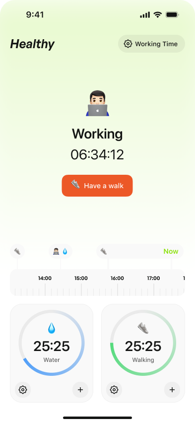
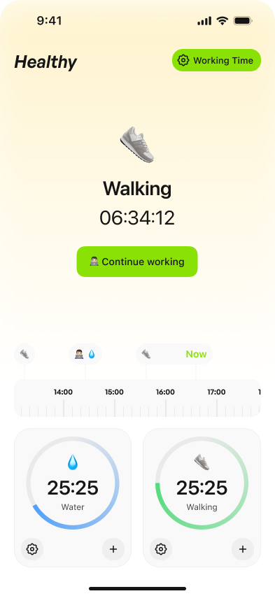
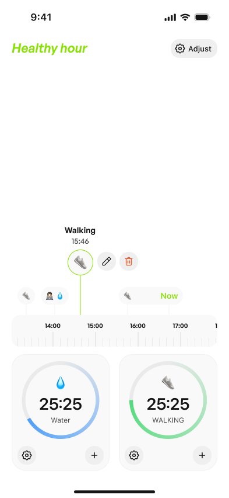
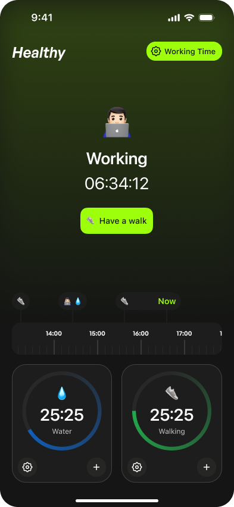
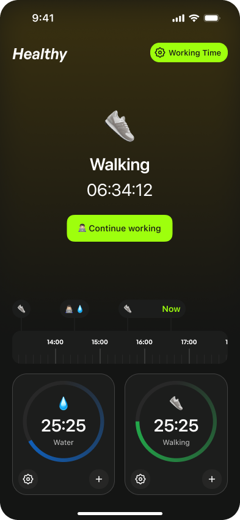
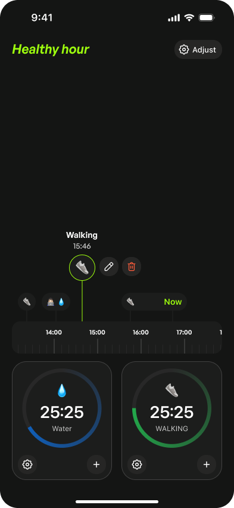

# Healthy Hour

[](https://github.com/kaysman/healthy_hour/actions/workflows/ci.yml)
[](LICENSE)

A Flutter app for **Healthy Hour** — alternates between Working and Walking
sessions and reminds you to drink water and to get up and walk, including
while the app is closed.

Bloc + Hive, feature-first folders inside `lib/`, with a single shared
package for the design system.

> **Status:** built in the open. Sessions, live countdowns and reminders
> work end to end; it is not on any store and has no sync.
> [What's done and what isn't](#status).

## Screens

All six screens below are the Home surface in different states / themes.
Settings is reached via the `Working Time` / `Adjust` pill
in the top-right.

### Light theme

| Working                                                                                                                                                                                   | Walking                                                                                                                                                                    | Session selected                                                                                                                                                                                                          |
| ----------------------------------------------------------------------------------------------------------------------------------------------------------------------------------------- | -------------------------------------------------------------------------------------------------------------------------------------------------------------------------- | ------------------------------------------------------------------------------------------------------------------------------------------------------------------------------------------------------------------------- |
|                                                                                                                                            |                                                                                                                           |                                                                                                                                                                 |
| Working session running. Soft green tint at the top, `🧑‍💻` hero with live `06:34:12` duration, `Have a walk` CTA, ruler timeline anchored to **Now**, Water 💧 + Walking 👟 cards beneath. | Walking session running. Tint shifts to warm yellow, hero swaps to `👟`, CTA flips to `Continue working`. The `Working Time` pill turns into the brand-green active state. | A past `Walking` segment is tapped on the timeline. The selected bar is ringed in green; an actions card (edit ✏️ / delete 🗑️) animates in above the strip. Tapping edit opens a time picker; delete removes the session. |

### Dark theme

| Working                                                                                       | Walking                                                                              | Session selected                                                                                            |
| --------------------------------------------------------------------------------------------- | ------------------------------------------------------------------------------------ | ----------------------------------------------------------------------------------------------------------- |
|                                               |                                      |                                                    |
| Same layout, dark surface. Working tint is a deep green wash at the top fading to near-black. | Walking tint is a warm amber wash, brand-green CTA pops against the dark background. | Selection + actions card on dark surface, with the same green selection ring and edit / delete affordances. |

### Settings — `/settings`

- **Working window** — start / end time chips; tap to open a `TimePicker`.
- **Water reminder** — interval slider, 5–90 minutes. Drives the Water
  ring on Home and the water notifications.
- **Walking reminder** — interval slider, same range. Drives the Walking
  ring on Home and the walking notifications.

On Home, the `+` on the Water card logs a drink and restarts that
countdown; the `+` on the Walking card starts a walk.

## How the timer works

There is no countdown, and nothing accumulates elapsed time.

A `Session` stores two fields that matter: `startedAt`, and a nullable
`endedAt`. The session whose `endedAt` is still null is the one you're in.
`HomeBloc` ticks once a second, and the only thing that tick does is push
the current wall-clock `now` into state:

```dart
Duration durationAt(DateTime moment) => (endedAt ?? moment).difference(startedAt);
```

Every number on screen — the hero duration, the timeline segments, the
water and walking rings — is derived from that. The state object holds no
counter:

```dart
Duration get currentDuration => current?.durationAt(now) ?? Duration.zero;
```

The useful consequence is that there is nothing to drift. Backgrounding the
app, being killed by the OS, or coming back hours later all yield the right
duration, because the duration was never stored — it is recomputed from two
timestamps and the current clock. Editing a past session is just moving a
timestamp, and every derived value follows for free.

The same choice is what makes the timeline editable at all. Sessions are an
append-only log of what actually happened, not a machine with a running
total, so "delete this walk" or "that walk started 10 minutes earlier" are
ordinary edits rather than surgery on accumulated state.

`HomeBloc` also takes an injectable `Clock`, which is what makes any of this
testable without waiting in real time.

The Water and Walking rings follow the same rule. Water counts down from
the last logged drink (never from before today's working window opens, so
each day starts full); Walking counts down from the start of the current
Working session. Both are `interval − (now − anchor)`, computed per tick.

## How reminders work

Notifications are planned from the same timestamps, so what the phone
says and what Home shows cannot disagree.

- **A pure planner.** `planReminders` in `domain/usecases/` takes `now`,
  the current session, the last drink, the working window and the two
  intervals, and returns every reminder due from now on. No Flutter, no
  plugin — it is plain Dart and has the largest test file in the repo.
- **Replace, don't diff.** `ReminderCoordinator` watches the session,
  settings and hydration streams. Whenever any of them changes it
  recomputes the whole plan and the scheduler cancels everything pending
  and schedules the new plan. There is no background job and no stored
  schedule to fall out of sync; the OS just holds the latest plan.
- **Only inside the working window**, and water also covers tomorrow's
  window, so the next morning gets reminders without opening the app.
  The plan is capped at 60 entries because iOS keeps at most 64 pending
  local notifications and silently drops the rest.
- **Inexact on purpose.** Android delivery uses
  `inexactAllowWhileIdle`. Exact alarms need `SCHEDULE_EXACT_ALARM`,
  which Android 14 denies by default and Play restricts to alarm and
  calendar apps; a water reminder a minute late costs nothing.

The plugin (`flutter_local_notifications`) sits behind a domain
`ReminderScheduler` interface, so the planner and coordinator are tested
against a fake that records what would have been scheduled.

## Layout

```
healthy_hour/
├─ android/                       # generated by `flutter create`
├─ ios/                           # generated by `flutter create`
├─ lib/
│  ├─ main.dart                   # entrypoint
│  └─ src/
│     ├─ app.dart, app_observer.dart, router.dart
│     ├─ core/                    # DateTime/Duration extensions, typedefs
│     ├─ domain/                  # pure-Dart entities, repos, use-cases, reminder planner
│     ├─ data/                    # Hive repositories + local-notification scheduler
│     └─ features/
│        ├─ home/                 # HomeBloc + HomePage + widgets (incl. embedded timeline)
│        ├─ reminders/            # ReminderCoordinator: data changes → new schedule
│        └─ settings/             # SettingsBloc + SettingsPage
├─ test/                          # mirrors lib/src: domain, data, features
├─ packages/
│  └─ healthy_hour_ui_kit/        # design system: theme, icons, widgets, DurationFormatter
├─ pubspec.yaml
└─ analysis_options.yaml
```

`healthy_hour_ui_kit` is the only local package — kept separate so the
design system has no app coupling and can be reused (companion apps,
storybooks, marketing site). It's wired in via a `path:` dependency in
`pubspec.yaml`.

## First-time setup

The `android/` and `ios/` projects are committed, so there is no
`flutter create` step. Bundle id is `com.ikayapps.healthy_hour`.

```bash
flutter pub get
```

## Running

```bash
flutter run
```

## Quality gates

All three run on every push and pull request — see
[`.github/workflows/ci.yml`](.github/workflows/ci.yml).

```bash
dart format --set-exit-if-changed .
flutter analyze
flutter test
```

`flutter analyze` and `dart format` cover `packages/` from the root, but
`flutter test` does not — the design system has its own suite:

```bash
cd packages/healthy_hour_ui_kit && flutter test
```

### What the tests cover

79 tests in the app, laid out to mirror `lib/src/`:

- **Domain (36)** — session durations, the countdown rules, the
  switch/start use-cases (including discarding sub-minute sessions), and
  the reminder planner: window edges, the next-day roll-over, the iOS cap,
  zero intervals.
- **Features (36)** — `HomeBloc` and `SettingsBloc` with `bloc_test` and a
  fixed `Clock`; the ring math on `HomeState`; the one-second ticker under
  `fakeAsync`; `ReminderCoordinator` against a recording scheduler; widget
  tests that tap the Water and Walking `+` buttons and the Settings back
  button on the real Home page.
- **Data (6)** — the Hive repositories against a real box in a temp dir.

No test waits in real time.

## Status

Working:

- Home — working/walking switching, live duration, water and walking rings
  that count down, drink logging, and an interactive timeline you can pan,
  pinch-zoom, select, edit, delete.
- Reminders — water and walking notifications inside the working window,
  delivered while the app is closed and restored after a reboot.
- Settings — working window, water interval, walking interval.
- Local persistence through Hive, with the domain layer kept pure Dart.
- Design system extracted to `packages/healthy_hour_ui_kit`.
- Light and dark themes.
- `flutter analyze` clean under `very_good_analysis`; 79 app tests in CI.

Not there yet:

- **Reminders are not actionable.** A notification opens the app; there is
  no "I drank" or "start walk" button on the notification itself yet.
- **Drinks are a timestamp, not a log.** Only the last drink is stored, so
  there is no daily water total or history.
- **No sync, no accounts.** Everything is on-device. An Express + Prisma +
  Postgres service — JWT auth, session CRUD, settings — is written but is
  not wired to the app or published yet.
- Not on any store.

## Code generation

`hive_ce_generator` produces `*.g.dart` files for Hive type adapters:

```bash
dart run build_runner build --delete-conflicting-outputs
```

## License

[MIT](LICENSE) © Atabek Kadir
